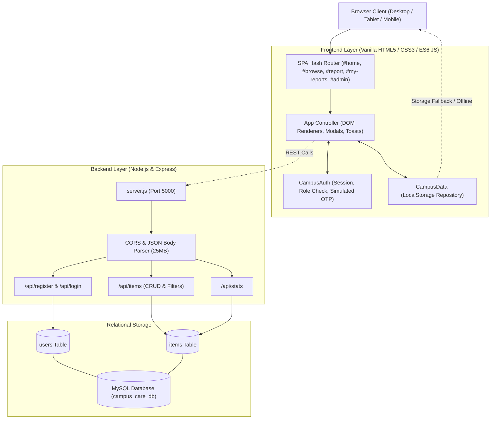
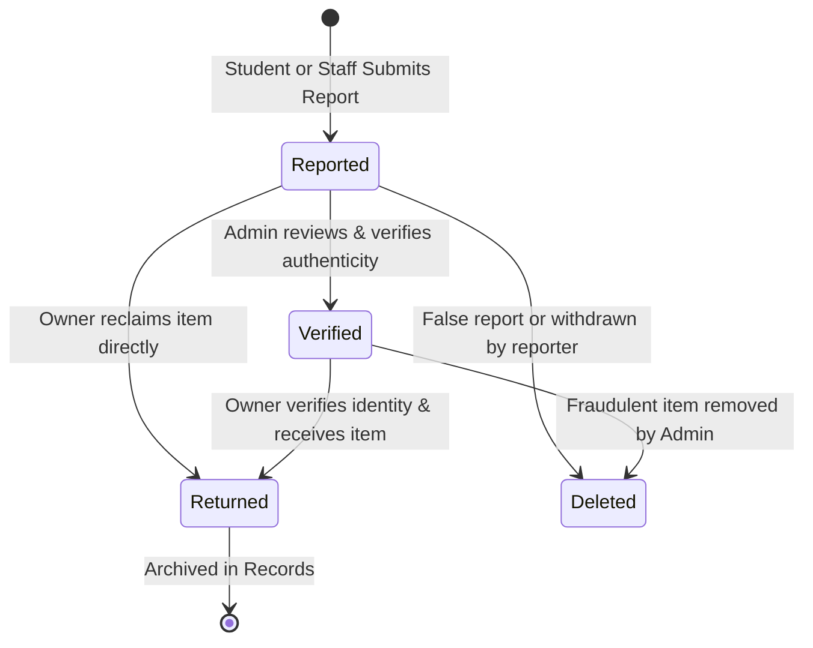
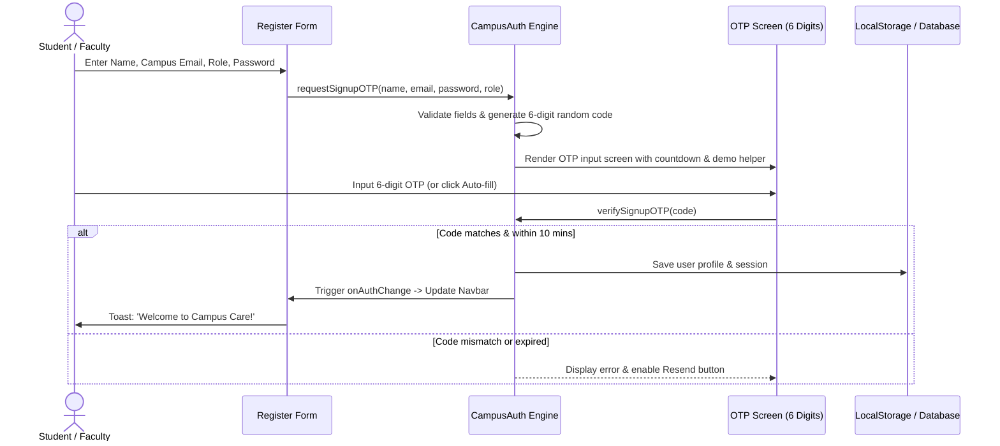

# Campus Care – Lost & Found Portal: Comprehensive Project Analysis

> **Project Name:** Campus Care – A Digital Platform for Lost & Found Items  
> **Project Type:** College Community Engagement / CEP Project  
> **Repository Root:** `c:\Users\chede appliances\OneDrive\Desktop\campus care`  
> **Document Date:** September 2026  
> **Status:** Fully Functional & Actively Running  

---

## Table of Contents
1. [Executive Summary](#1-executive-summary)
2. [High-Level Architecture](#2-high-level-architecture)
3. [File-by-File Technical Deep Dive](#3-file-by-file-technical-deep-dive)
   - [Frontend Core (HTML, CSS, Client JS)](#frontend-core)
   - [Backend Core (Node.js, Express, MySQL)](#backend-core)
4. [System Flow & Visual Diagrams](#4-system-flow--visual-diagrams)
5. [Data Models & Database Schema](#5-data-models--database-schema)
6. [REST API Specification](#6-rest-api-specification)
7. [User Journeys & Functional Modules](#7-user-journeys--functional-modules)
8. [Live Server Execution & How to Run](#8-live-server-execution--how-to-run)
9. [Key Strengths & Recommended Enhancements](#9-key-strengths--recommended-enhancements)

---

## 1. Executive Summary

**Campus Care** is a digital solution designed to modernize campus lost-and-found operations. Traditionally, college campuses rely on scattered physical notice boards, disconnected WhatsApp groups, or delayed visits to campus security desks. Campus Care replaces these fragmented methods with a unified, transparent, and mobile-responsive digital portal.

### Core Value Proposition
- **Fast Reporting:** Students and faculty can register lost or found items in under 60 seconds with photos, locations, and descriptions.
- **Instant Search & Multi-Criteria Filtering:** Allows students to search by keyword, category, status (Lost vs. Found), and 10 specific campus zones.
- **Direct & Secure Claiming:** Provides direct email links, WhatsApp chat triggers, and an in-app claim verification message sender.
- **Administrative Lifecycle Management:** Campus security officers can verify items, resolve claims, prevent fraudulent postings, and track metrics.
- **Dual-Tier Resilience:** Built as a standalone client-side Single Page Application (SPA) powered by `localStorage` for zero-configuration instant demo presentation, complemented by a full Node.js/Express/MySQL backend for persistent enterprise deployment.

---

## 2. High-Level Architecture

The project is structured with clean separation of concerns between presentation, business logic, storage, and server APIs:

```
campus care/
├── index.html                   # Core Single Page Application entrypoint (5 views, 4 modals)
├── css/
│   └── style.css                # 3,200+ lines of custom CSS (Tokens, Responsive Grid, Access Denied UI)
├── js/
│   ├── config.js                # Global configuration defining single designated VITE_ADMIN_EMAIL
│   ├── data.js                  # Client data management layer (LocalStorage repository + admin guards)
│   ├── auth.js                  # Authentication manager, single admin check & simulated OTP
│   └── app.js                   # SPA router, route protection, UI event bindings & modal controller
├── backend/
│   ├── server.js                # Express REST API server with CORS and error handling
│   ├── package.json             # Backend dependencies (express, cors, dotenv, mysql2, bcryptjs)
│   ├── .env                     # Server, database, and single designated admin email config
│   ├── config/
│   │   └── db.js                # MySQL2 connection pool, auto-migration & seed loader
│   ├── middleware/
│   │   └── authMiddleware.js    # Single designated administrator authorization middleware
│   ├── controllers/
│   │   ├── authController.js    # Register, bcrypt login, user profile controllers
│   │   └── itemController.js    # Item CRUD, query search filters, status checks, and stats
│   ├── routes/
│   │   ├── authRoutes.js        # Auth endpoint router
│   │   └── itemRoutes.js        # Item endpoint router with requireAdmin deletion guard
│   └── database/
│       └── schema.sql           # MySQL database schema (users & items tables + seed records)
└── PROJECT_ANALYSIS.md          # Comprehensive technical report
```

### Technology Stack Summary

| Layer | Technologies Used | Description |
| :--- | :--- | :--- |
| **Frontend UI** | HTML5, Semantic Elements | Accessible markup with SEO meta tags, Google Fonts, and FontAwesome 6.5.1 |
| **Styling** | Vanilla CSS3 (Custom Design System) | Modern design tokens (HSL/HEX), glassmorphism, responsive flex/grid, micro-animations |
| **Frontend Logic** | Vanilla ES6+ JavaScript | Zero external frontend framework overhead; native hash-based SPA routing |
| **Client Storage** | Browser `localStorage` | Independent offline capability; seed items pre-populate automatically |
| **Backend Runtime** | Node.js (v24+) & Express.js (v4.19) | Scalable REST API, JSON parser with 25MB body limit for base64 photo payloads |
| **Security & Auth** | `bcryptjs` | Salted password hashing and dual demo account fallback authentication |
| **Database** | MySQL (via `mysql2/promise`) | Relational schema with connection pooling and automated initialization |

---

## 3. File-by-File Technical Deep Dive

### Frontend Core

#### 1. [`index.html`](file:///c:/Users/chede%20appliances/OneDrive/Desktop/campus%20care/index.html)
- **Size:** 56.8 KB (1,153 lines)
- **Role:** Main HTML structure containing the application layout, 5 distinct views, 4 modal dialogs, and toast containers.
- **Key Sections:**
  1. **Top Announcement Bar:** Displays college affiliation and real-time network status pill (`Campus Care Network Active`).
  2. **Navigation Header (`#main-navbar`):** Responsive brand logo, desktop view links (`#home`, `#browse`, `#report`, `#my-reports`, `#admin`), authentication profile pill, dropdown menu, and mobile hamburger trigger.
  3. **Mobile Drawer Navigation (`#mobile-nav-drawer`):** Off-canvas slide-out drawer with backdrop for small screen viewports.
  4. **Home View (`#view-home`):**
     - Hero section with live counter pill, CTA buttons for *Report Lost Item* and *Report Found Item*, and floating preview card.
     - Live Campus Statistics Strip (`Total Reported`, `Active Lost`, `Found & Awaiting Claim`, `Successfully Returned`).
     - Recently Reported Items feed populated dynamically.
     - 3-step visual workflow (*Post a Quick Report* &rarr; *Search & Match* &rarr; *Safely Reclaim*).
     - Campus Security office notice banner.
  5. **Browse View (`#view-browse`):**
     - Search input with clear button and sort dropdown (*Newest*, *Oldest*, *A-Z*).
     - Segmented status switch (*All Items*, *Lost Items*, *Found Items*).
     - Location dropdown covering 10 campus landmarks.
     - Category pills (*Electronics*, *ID Cards & Docs*, *Keys*, *Books & Notes*, *Wallets & Bags*, *Clothing*, *Others*).
     - Dynamic items grid and empty state fallback.
  6. **Report View (`#view-report`):**
     - Interactive *Lost* vs. *Found* toggle button group.
     - Comprehensive form: item name, category, date picker, location input with 5 quick-pick buttons, detailed description.
     - Drag-and-drop file upload zone with instant image preview, plus 7 stock campus photo chips.
     - Contact details fields (pre-filled from active session).
  7. **My Reports View (`#view-my-reports`):**
     - Filter sub-tabs (*All*, *Active/Reported*, *Verified*, *Returned/Resolved*).
     - Cards showing user-submitted items with quick action controls (*Mark Returned*, *Edit*, *Delete*).
  8. **Admin Console (`#view-admin`):**
     - 4 executive metric counters (*Total Submissions*, *Pending Review*, *Verified Active*, *Returned to Owner*).
     - Management data table with search, status filter, and type filter.
     - Admin action buttons (*Verify*, *Mark Returned*, *Delete*, *Reset Demo Data*).
  9. **Modals:**
     - **Item Details Modal (`#modal-item-details`):** Full photo modal, metadata breakdown, status pill, reporter card.
     - **Contact Reporter Modal (`#modal-contact-reporter`):** Direct email, WhatsApp link trigger, and in-app claim verification textarea.
     - **Edit Report Modal (`#modal-edit-report`):** Full editing capabilities for existing reports.
     - **Auth Modal (`#modal-auth`):** Tabbed Login/Register, 1-click demo switcher (Student, Faculty, Admin), and a complete 2-step OTP verification flow with 6 individual digit input boxes.

#### 2. [`css/style.css`](file:///c:/Users/chede%20appliances/OneDrive/Desktop/campus%20care/css/style.css)
- **Size:** 61.0 KB (3,166 lines)
- **Role:** Comprehensive styling system built without bulky third-party CSS frameworks.
- **Key Modules:**
  - **CSS Custom Properties (Variables):** Standardized color palettes (`--primary: #2563eb`, `--lost-color: #ef4444`, `--found-color: #059669`, `--returned-color: #7c3aed`), semantic surface elevations, and slate neutrals.
  - **Typography:** Uses Google Fonts (`Plus Jakarta Sans` for body text, `Outfit` for display headings).
  - **Glassmorphism & Elevation:** Subtle shadows (`--shadow-md`, `--shadow-xl`), rounded borders (`--radius-md: 12px`, `--radius-lg: 16px`), and smooth transition easing curves.
  - **Responsive Layouts:** Flexbox headers, responsive CSS grids (`repeat(auto-fill, minmax(320px, 1fr))`), and media queries for tablets (`max-width: 992px`) and mobile phones (`max-width: 768px`, `max-width: 480px`).
  - **Animation Library:** Keyframe animations for `@keyframes pulse`, `fadeIn`, `slideUp`, and button hover effects.

#### 3. [`js/data.js`](file:///c:/Users/chede%20appliances/OneDrive/Desktop/campus%20care/js/data.js)
- **Size:** 8.7 KB (257 lines)
- **Role:** Client-side data access layer managing items via `CampusData`.
- **Seed Data:** Contains 8 realistic campus records (MacBook Air, Hydro Flask, Student ID Card, Honda Civic Car Key, Mathematics Textbook, Leather Wallet, Sony Headphones, Vintage Denim Jacket).
- **Core Methods:**
  - `init()`: Checks `localStorage` under `campus_care_items_v2` and seeds data if empty.
  - `getAll()`: Returns all active items.
  - `getById(id)`: Finds an item by its unique ID.
  - `add(itemData)`: Generates ID `item-${Date.now()}`, sets default status to `Reported`, prepends to array, and saves to storage.
  - `update(id, updates)`: Merges partial updates into target item.
  - `delete(id)`: Removes item by ID.
  - `getByReporterEmail(email)`: Queries user-specific submissions.
  - `getMetrics()`: Calculates aggregate counts for total, lost, found, returned, verified, and reported items.
  - `resetSampleData()`: Clears customized entries and reloads the pristine 8-item sample set.

#### 4. [`js/auth.js`](file:///c:/Users/chede%20appliances/OneDrive/Desktop/campus%20care/js/auth.js)
- **Size:** 7.8 KB (285 lines)
- **Role:** Authentication state manager handling user sessions, roles, and simulated OTP verification.
- **Preset Demo Accounts:**
  - `Student`: Alex Johnson (`alex.j@campus.edu`)
  - `Faculty`: Dr. Sarah Watson (`s.watson@campus.edu`)
  - `Admin`: Chief Security Officer Miller (`admin@campus.edu`)
- **Key Methods:**
  - `init()`: Restores session from `campus_care_user_v2` (defaults to Student demo for instant live feel).
  - `login(email, password)`: Validates credentials, checks demo presets or registered accounts, and triggers auth listeners.
  - `requestSignupOTP(name, email, password, role)`: Generates a 6-digit cryptographic-style OTP, stores a pending signup state with a 10-minute expiry window, and returns demo verification data.
  - `verifySignupOTP(code)`: Validates the 6-digit input against the pending signup session and completes account registration.
  - `resendSignupOTP()`: Re-generates a fresh 6-digit OTP code and resets countdown.
  - `isAdmin()`: Returns boolean checking if the current user holds the Admin role.
  - `onAuthChange(callback)`: Observer pattern to notify UI components whenever user state changes.

#### 5. [`js/app.js`](file:///c:/Users/chede%20appliances/OneDrive/Desktop/campus%20care/js/app.js)
- **Size:** 60.7 KB (1,624 lines)
- **Role:** Main Single Page Application coordinator.
- **Key Functional Subsystems:**
  - **Routing (`bindRouting`, `handleRoute`, `navigateToView`):** Listens to `window.location.hash`, manages view transitions with `.hidden` and `.active` classes, and scrolls viewport to top.
  - **Home Rendering (`renderHomeView`):** Updates metric counter numbers and renders the top 3 latest reported item cards.
  - **Browse & Filter Engine (`bindBrowseEvents`, `renderBrowseView`):** Combines keyword search (matching name, description, location, category), status segmenting (Lost vs. Found vs. All), campus location dropdown, and category pill selection. Includes an item card builder with badges, images, and date formats.
  - **Report Handler (`bindReportEvents`, `handleReportSubmit`):** Manages the Lost/Found toggle, drag-and-drop file ingestion with FileReader `readAsDataURL` base64 encoding, validation, and submission feedback.
  - **Personal Dashboard (`renderMyReports`, `attachMyReportsActionHandlers`):** Filters reports matching the logged-in email and provides quick status resolution and edit modals.
  - **Admin Controller (`renderAdminView`, `renderAdminTable`, `handleAdminAction`):** Renders table rows with action menus to verify claims, mark items as returned, or delete entries.
  - **OTP Verification UI Controller:** Manages automatic focus transitions between the 6 individual digit input boxes, backspace handling, clipboard auto-paste, countdown timer interval, and demo auto-fill.
  - **Toast Notifications (`showToast`):** Non-blocking animated alert banners for actions (e.g., "Item reported successfully", "Demo data reset").

---

### Backend Core

#### 1. [`backend/server.js`](file:///c:/Users/chede%20appliances/OneDrive/Desktop/campus%20care/backend/server.js)
- **Size:** 3.0 KB (102 lines)
- **Technology:** Node.js, Express.js.
- **Port:** Configured via `process.env.PORT` (defaults to `5000`).
- **Middlewares:**
  - `cors({ origin: '*', methods: ['GET', 'POST', 'PUT', 'DELETE', 'OPTIONS'] })` allows seamless cross-origin communication.
  - `express.json({ limit: '25mb' })` and `express.urlencoded({ limit: '25mb' })` accommodate high-resolution base64 image strings.
- **Routes Mounted:**
  - `/api/register` & `/api/login` via `authRoutes`
  - `/api/items` via `itemRoutes`
  - `/api/stats` for metric summaries
  - `/` Root health check endpoint detailing API directory.
  - Global 404 handler and 500 error handler middleware.

#### 2. [`backend/config/db.js`](file:///c:/Users/chede%20appliances/OneDrive/Desktop/campus%20care/backend/config/db.js)
- **Size:** 4.4 KB (121 lines)
- **Technology:** `mysql2/promise` connection pool.
- **Connection Configuration:** Host `localhost`, user `root`, password empty, database `campus_care_db`, port `3306`.
- **Auto-Initialization Logic (`initDB()`):**
  1. Establishes connection without database specified to execute `CREATE DATABASE IF NOT EXISTS campus_care_db`.
  2. Tests pool connection to the target database.
  3. Executes `CREATE TABLE IF NOT EXISTS` for both `users` and `items` tables.
  4. Inspects row count in `items`; if empty, reads and executes SQL statements from `database/schema.sql` to automatically seed demo records.
  5. Catches connection errors gracefully so the Express server continues running even if MySQL is offline.

#### 3. [`backend/controllers/authController.js`](file:///c:/Users/chede%20appliances/OneDrive/Desktop/campus%20care/backend/controllers/authController.js)
- **Size:** 5.6 KB (220 lines)
- **Methods:**
  - `register(req, res)`: Validates full name, email format regex, password length; checks duplicate emails; hashes password using `bcrypt.hash` (10 rounds); inserts user into MySQL.
  - `login(req, res)`: Retrieves user by lowercase email; validates password using `bcrypt.compare` with fallback for preset passwords (`password123`, `admin123`); returns sanitized user object (omitting password hash).
  - `getUsers(req, res)`: Lists registered accounts for administrative inspection.
  - `getProfile(req, res)`: Fetches profile data by user ID.

#### 4. [`backend/controllers/itemController.js`](file:///c:/Users/chede%20appliances/OneDrive/Desktop/campus%20care/backend/controllers/itemController.js)
- **Size:** 12.3 KB (425 lines)
- **Dual-Field Support (`formatItem`):** Formats database rows into dual-cased objects supporting both snake_case (`item_name`, `reporter_email`) and frontend camelCase (`name`, `reporterEmail`) for zero-friction interoperability.
- **Methods:**
  - `getItems(req, res)`: Dynamic SQL query builder filtering by `type` (Lost/Found), `category`, `location` (LIKE), `reporterEmail`, `status`, and keyword search (`item_name LIKE`, `description LIKE`, etc.), sorted by `created_at DESC`.
  - `getItemById(req, res)`: Fetches single item.
  - `createItem(req, res)`: Validates mandatory fields and inserts new item.
  - `updateItem(req, res)`: Updates existing item attributes.
  - `deleteItem(req, res)`: Deletes an item by ID.
  - `getItemStats(req, res)`: Computes aggregate counts for `total`, `lost`, `found`, `returned`, `verified`, and `reported`.

#### 5. [`backend/routes/authRoutes.js`](file:///c:/Users/chede%20appliances/OneDrive/Desktop/campus%20care/backend/routes/authRoutes.js) & [`backend/routes/itemRoutes.js`](file:///c:/Users/chede%20appliances/OneDrive/Desktop/campus%20care/backend/routes/itemRoutes.js)
- Clean Express routers connecting endpoints to their respective controller handlers.

#### 6. [`backend/database/schema.sql`](file:///c:/Users/chede%20appliances/OneDrive/Desktop/campus%20care/backend/database/schema.sql)
- **Size:** 6.2 KB (74 lines)
- Contains complete DDL scripts for database and table creation, indexes, foreign key constraints (`FOREIGN KEY (user_id) REFERENCES users(id) ON DELETE SET NULL`), and seed statements with realistic campus scenarios.

---

## 4. System Flow & Visual Diagrams

### System Architecture



### Item Lifecycle State Machine



### Authentication & OTP Verification Flow



---

## 5. Data Models & Database Schema

### Entity: `users`
| Column | Type | Constraints | Description |
| :--- | :--- | :--- | :--- |
| `id` | `INT` | Primary Key, Auto Increment | Unique User ID |
| `name` | `VARCHAR(255)` | NOT NULL | User's full name |
| `email` | `VARCHAR(255)` | NOT NULL, UNIQUE | Campus email identifier |
| `password` | `VARCHAR(255)` | NOT NULL | Bcrypt hashed password |
| `branch` | `VARCHAR(100)` | NULL | College department/major |
| `year` | `VARCHAR(50)` | NULL | Academic year (e.g. 3rd Year) |
| `role` | `VARCHAR(50)` | DEFAULT `'Student'` | `'Student'`, `'Faculty'`, or `'Admin'` |
| `phone` | `VARCHAR(50)` | NULL | Contact phone / WhatsApp |
| `created_at` | `TIMESTAMP` | DEFAULT CURRENT_TIMESTAMP | Registration timestamp |

### Entity: `items`
| Column | Type | Constraints | Description |
| :--- | :--- | :--- | :--- |
| `id` | `INT` | Primary Key, Auto Increment | Unique Item ID |
| `user_id` | `INT` | Foreign Key &rarr; `users(id)`, NULL | Linked reporter account |
| `type` | `ENUM('Lost','Found')`| NOT NULL | Classification type |
| `item_name` | `VARCHAR(255)` | NOT NULL | Name / title of item |
| `description`| `TEXT` | NULL | Detailed notes, stickers, marks |
| `category` | `VARCHAR(100)` | NOT NULL | Electronics, Keys, ID Cards, etc. |
| `location` | `VARCHAR(255)` | NOT NULL | Exact campus location |
| `date` | `VARCHAR(50)` | NOT NULL | Date lost or found (YYYY-MM-DD) |
| `image` | `LONGTEXT` | NULL | URL or base64 data URI |
| `status` | `VARCHAR(50)` | DEFAULT `'Reported'` | `'Reported'`, `'Verified'`, `'Returned'` |
| `reporter_name`| `VARCHAR(255)` | NULL | Contact person name |
| `reporter_email`| `VARCHAR(255)`| NULL | Contact email address |
| `reporter_phone`| `VARCHAR(50)` | NULL | Contact telephone / WhatsApp |
| `reporter_role` | `VARCHAR(50)` | DEFAULT `'Student'` | Student, Faculty, Staff |
| `created_at`| `TIMESTAMP` | DEFAULT CURRENT_TIMESTAMP | Timestamp item was reported |

---

## 6. REST API Specification

Base URL: `http://localhost:5000/api`

| Method | Endpoint | Description | Request Body / Parameters | Response Status |
| :--- | :--- | :--- | :--- | :--- |
| `GET` | `/` | API Information & Directory | None | `200 OK` |
| `POST` | `/api/register` | Register new user | `{ name, email, password, role, branch, year, phone }` | `201 Created` / `400 Bad Request` |
| `POST` | `/api/login` | Authenticate user | `{ email, password }` | `200 OK` / `401 Unauthorized` |
| `GET` | `/api/users` | List all users | None | `200 OK` |
| `GET` | `/api/profile/:id` | Fetch user profile | Path param `:id` | `200 OK` / `404 Not Found` |
| `GET` | `/api/items` | Retrieve items with search & filters | Query params: `?type=Lost\|Found`, `?category=...`, `?location=...`, `?search=...`, `?status=...`, `?reporterEmail=...` | `200 OK` |
| `GET` | `/api/items/:id` | Retrieve single item by ID | Path param `:id` | `200 OK` / `404 Not Found` |
| `POST` | `/api/items` | Create new Lost / Found report | `{ type, item_name, description, category, location, date, image, reporter_name, reporter_email, reporter_phone, reporter_role }` | `201 Created` / `400 Bad Request` |
| `PUT` | `/api/items/:id` | Update existing item | Path param `:id`, `{ type, item_name, description, category, location, status, ... }` | `200 OK` / `404 Not Found` |
| `DELETE`| `/api/items/:id` | Delete item report | Path param `:id` | `200 OK` / `404 Not Found` |
| `GET` | `/api/stats` | Aggregated metric counts | None | `200 OK` (`{ metrics: { total, lost, found, returned, verified, reported } }`) |

---

## 7. User Journeys & Functional Modules

### 1. Reporting a Belonging (Lost or Found)
1. User clicks **"Report Lost Item"** or **"Report Found Item"** on the hero banner or navbar.
2. The form automatically pre-selects the type and pre-fills the logged-in user's name, email, role, and phone.
3. User enters the item title, picks a category from the dropdown, enters the date, and picks or types the campus location.
4. User uploads a photo (drag-and-drop or file selector) or picks a pre-built stock campus photo chip.
5. User submits; the system validates required fields, adds the record to storage, presents an animated toast, and redirects to `#browse` or `#my-reports`.

### 2. Searching & Filtering the Directory
1. User navigates to **"Browse Items"**.
2. Live search bar filters items in real time as the user types keywords.
3. Segment buttons switch between *All*, *Lost Items*, and *Found Items*.
4. Category pills allow instant switching between *Electronics*, *ID Cards*, *Keys*, *Books*, etc.
5. Location selector limits results to specific buildings (e.g. *Central Library*, *Cafeteria*, *Engineering Complex*).
6. Sort dropdown arranges items by newest, oldest, or alphabetical order.

### 3. Claiming & Contacting the Reporter
1. User clicks on any card in the browse grid.
2. The **Item Details Modal** opens with high-resolution imagery and metadata.
3. User clicks **"Contact Reporter"** to open the communication modal.
4. User can:
   - Click **"Send Email"** to launch `mailto:` with pre-filled subject and item details.
   - Click **"Chat"** to trigger direct WhatsApp conversation (`https://wa.me/...`).
   - Type a verification message (e.g., providing secret item marks or unlock passcode) and transmit it via in-app notification.

### 4. Administrative Moderation
1. Campus Security logs in with the designated administrator email (e.g., `admin@college.edu`).
2. The navbar activates the **"Admin Panel"** link (hidden from all other normal users).
3. The dashboard displays 4 summary cards (Total, Pending Review, Verified, Returned).
4. The administrative table allows searching reports and filtering by status and type.
5. Admins can click **"Verify"** to mark reported items as legitimate, **"Mark Returned"** once an owner collects their belongings, or **"Delete"** to purge invalid postings.
6. The **"Reset Demo Data"** button instantly restores clean test records for demo presentations.

---

## 7.5. Single Designated Administrator Security Enforcement

### 1. Designated Administrator Email Configuration
- **Configuration Key:** `VITE_ADMIN_EMAIL` (Client) and `ADMIN_EMAIL` (Server).
- **Default Value:** `admin@college.edu`.
- **Easy Customization:** Modify `window.APP_CONFIG.VITE_ADMIN_EMAIL` in `js/config.js` and `VITE_ADMIN_EMAIL` in `backend/.env`.
- **Zero Role Privilege Escalation:** User roles (`Student`, `Faculty`, `Staff`, or manipulated strings) **never** grant admin rights. Admin status is determined strictly by verifying if `currentUser.email === VITE_ADMIN_EMAIL`.

### 2. Navbar Visibility
- Normal users see only: **Home**, **Browse Items**, **Report Item**, **My Reports**, and **Profile**.
- **Admin Panel** link is hidden (`display: none;` and `.hidden`) from the desktop menu, mobile drawer, and user profile dropdown for all non-admin accounts.
- The link is revealed only when an active session matches `VITE_ADMIN_EMAIL`.

### 3. Route Protection (`#admin` & `/admin`)
- If an unauthenticated user or normal user (student/staff) navigates directly to `#admin` or `/admin`:
  - The admin dashboard content is strictly hidden.
  - An **Access Denied** interface is rendered with:
    - Heading: `Access Denied`
    - Subtitle: `You do not have permission to access the Campus Care Administration Panel.`
    - Session details showing current account vs. authorized administrator.
    - Button: `Return to Home` (redirects to `/` / `#home`).

### 4. Administrative Actions Protection
- **Delete Item:** Restricted to the designated administrator. Blocked at both frontend (`CampusData.delete`) and backend (`DELETE /api/items/:id` via `requireAdmin` middleware, returning `403 Forbidden`).
- **Mark as Returned / Verify:** Restricted to the designated administrator. In My Reports, normal users see an "Admin Managed" badge instead of return/delete buttons. In backend, `PUT /api/items/:id` checks admin credentials before mutating status to `Returned` or `Verified`.

---

## 8. Live Server Execution & How to Run

### Currently Active Servers

Both frontend and backend services are active and running in the background:

| Service | Port | Local URL | Status |
| :--- | :--- | :--- | :--- |
| **Web Application Frontend** | `3000` | [http://localhost:3000](http://localhost:3000) | **ACTIVE & SERVING** (HTTP 200 OK) |
| **Node.js Express REST API** | `5000` | [http://localhost:5000](http://localhost:5000) | **ACTIVE & SERVING** (HTTP 200 OK) |

### How to Run Locally

#### 1. Running the Web Frontend
From the workspace root (`campus care/`):
```powershell
# Option A: Using Python built-in server (Currently active on port 3000)
python -m http.server 3000

# Option B: Using Node http-server / serve
npx -y serve -l 3000 .
```
Then open your browser to [http://localhost:3000](http://localhost:3000).

#### 2. Running the Backend API
From the `backend/` directory:
```powershell
cd backend
npm install
node server.js
```
The API server will listen on port `5000`.

#### 3. Setting Up MySQL (Optional for Full Database Persistence)
1. Start MySQL via XAMPP Control Panel or Windows Service on port `3306`.
2. Verify `.env` credentials in `backend/.env`:
   ```ini
   PORT=5000
   DB_HOST=localhost
   DB_USER=root
   DB_PASSWORD=
   DB_NAME=campus_care_db
   DB_PORT=3306
   ```
3. When `node server.js` runs, `initDB()` will automatically create the `campus_care_db` database, generate the tables, and load all seed records from `schema.sql`.

---

## 9. Key Strengths & Recommended Enhancements

### Key Strengths
1. **Zero-Configuration Presentation Mode:** Thanks to the built-in LocalStorage layer (`data.js` and `auth.js`), the web application runs with full functionality (auth, report submission, multi-criteria search, admin actions, photo upload) without requiring MySQL to be active.
2. **Enterprise Dual Architecture:** Includes a full Node.js/Express backend and MySQL relational schema ready for live campus hosting.
3. **Responsive UI/UX:** Crafted with high-grade modern aesthetics, fluid layout grids, glassmorphism badges, and smooth transitions.
4. **Rich Seed Data:** Features realistic student and staff lost-and-found scenarios with photos and contact details.
5. **Interactive OTP Experience:** Includes a 6-box segmented OTP interface with keyboard navigation, timer countdown, and an auto-fill helper.

### Recommended Future Enhancements
1. **Live Dual-Sync Switcher:** Add a frontend toggle switch in the footer/admin panel to switch data sources between `LocalStorage (Offline Demo)` and `REST API (Live MySQL)` dynamically.
2. **Real SMTP Email Integration:** Connect Nodemailer to the Express backend to send actual email verification codes and notification emails when someone claims an item.
3. **Automated Image Compression:** Implement a canvas-based client-side image resizer before converting uploads to base64 to minimize memory consumption on mobile devices.
4. **Push Notifications:** Introduce Web Push Notifications or WebSockets to alert students the moment an item matching their search is reported.

---
*Report generated for Campus Care CEP Project. Developed with HTML5, CSS3, JavaScript, Node.js, Express, and MySQL.*
