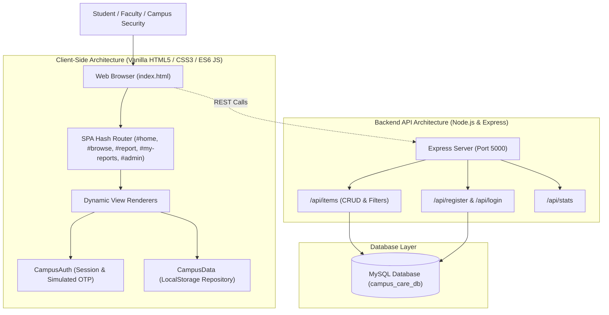
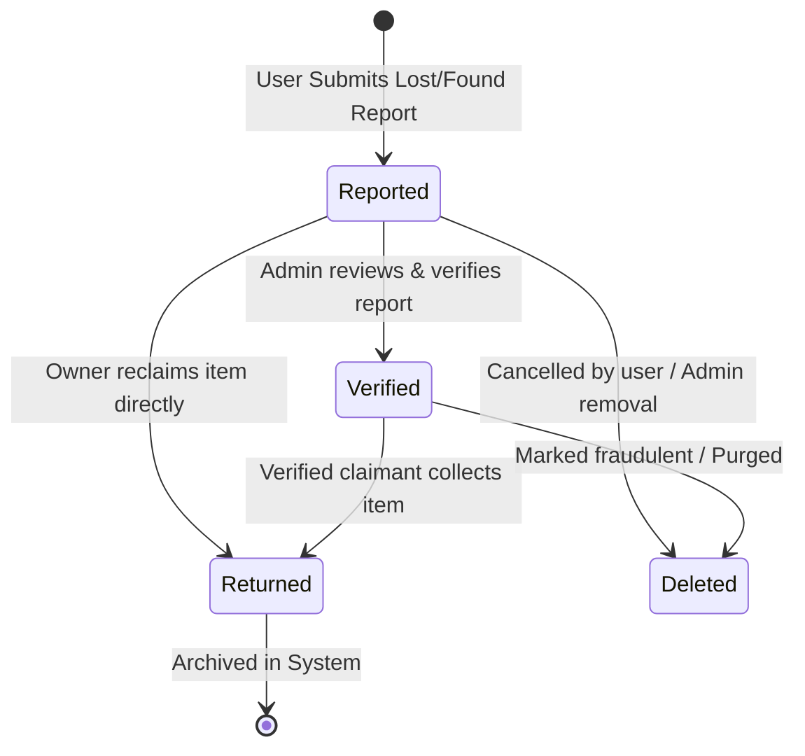

# Campus Care – Complete Project Analysis & System Architecture

> **Project Title:** Campus Care – A Digital Platform for Lost & Found Items  
> **Platform Classification:** College CEP (Community Engagement Project)  
> **Repository Location:** [campus care](file:///c:/Users/chede%20appliances/OneDrive/Desktop/campus%20care)  
> **Live Web Application:** [http://localhost:3000](http://localhost:3000) (Active)  
> **Backend REST API:** [http://localhost:5000](http://localhost:5000) (Active)  

---

## 1. Project Overview & Architecture

**Campus Care** is an end-to-end digital lost-and-found management solution designed for college campuses. It replaces fragmented physical notice boards and chat messages with a centralized web portal where students, faculty, and security personnel can report, search, claim, and moderate lost or found belongings.

---

## 2. File-by-File Breakdown

### Frontend Components

| File | Lines / Size | Key Responsibilities |
| :--- | :--- | :--- |
| [index.html](file:///c:/Users/chede%20appliances/OneDrive/Desktop/campus%20care/index.html) | 1,153 lines (56.8 KB) | Single Page Application markup with 5 views (`#view-home`, `#view-browse`, `#view-report`, `#view-my-reports`, `#view-admin`), 4 modals (Item Details, Contact Reporter with WhatsApp/Email, Edit Report, Auth with OTP), drawer navigation, and announcement bar. |
| [css/style.css](file:///c:/Users/chede%20appliances/OneDrive/Desktop/campus%20care/css/style.css) | 3,166 lines (61.0 KB) | Comprehensive vanilla CSS design system: custom design tokens, Google Fonts (`Plus Jakarta Sans` & `Outfit`), glassmorphism, responsive grid & flexbox layouts, animations (`@keyframes pulse`, `fadeIn`, `slideUp`), and mobile breakpoints. |
| [js/data.js](file:///c:/Users/chede%20appliances/OneDrive/Desktop/campus%20care/js/data.js) | 257 lines (8.7 KB) | Data layer (`CampusData`) managing `localStorage` persistence, 8 pre-seeded realistic campus items, CRUD operations, query filters by email, and real-time metric computations. |
| [js/auth.js](file:///c:/Users/chede%20appliances/OneDrive/Desktop/campus%20care/js/auth.js) | 285 lines (7.8 KB) | Authentication state engine (`CampusAuth`) managing user sessions, roles (Student, Faculty, Admin), demo presets, and a simulated 2-step 6-digit OTP verification process. |
| [js/app.js](file:///c:/Users/chede%20appliances/OneDrive/Desktop/campus%20care/js/app.js) | 1,624 lines (60.7 KB) | Application controller handling hash-based SPA routing, search & filter engine, drag-and-drop base64 image uploading, modal orchestration, and animated toast notifications. |

### Backend Components

| File | Lines / Size | Key Responsibilities |
| :--- | :--- | :--- |
| [backend/server.js](file:///c:/Users/chede%20appliances/OneDrive/Desktop/campus%20care/backend/server.js) | 102 lines (3.0 KB) | Express server bootstrapping, CORS configuration, 25MB body limit for base64 image payloads, API route registration, health check root, and error handling middleware. |
| [backend/config/db.js](file:///c:/Users/chede%20appliances/OneDrive/Desktop/campus%20care/backend/config/db.js) | 121 lines (4.4 KB) | MySQL2 connection pool with automated database creation (`CREATE DATABASE IF NOT EXISTS campus_care_db`), table schema validation, and automatic seed population from `schema.sql`. |
| [backend/controllers/authController.js](file:///c:/Users/chede%20appliances/OneDrive/Desktop/campus%20care/backend/controllers/authController.js) | 220 lines (5.6 KB) | Bcrypt-hashed user registration, credentials authentication with demo fallback, and user profile queries. |
| [backend/controllers/itemController.js](file:///c:/Users/chede%20appliances/OneDrive/Desktop/campus%20care/backend/controllers/itemController.js) | 425 lines (12.3 KB) | Full RESTful CRUD operations: dynamic multi-parameter SQL search and filtering, item creation, updates, deletions, and aggregate metrics. |
| [backend/routes/authRoutes.js](file:///c:/Users/chede%20appliances/OneDrive/Desktop/campus%20care/backend/routes/authRoutes.js) | 21 lines | Express router for `/api/register`, `/api/login`, `/api/users`, and `/api/profile/:id`. |
| [backend/routes/itemRoutes.js](file:///c:/Users/chede%20appliances/OneDrive/Desktop/campus%20care/backend/routes/itemRoutes.js) | 29 lines | Express router for `/api/items` endpoints and `/api/items/stats`. |
| [backend/database/schema.sql](file:///c:/Users/chede%20appliances/OneDrive/Desktop/campus%20care/backend/database/schema.sql) | 74 lines (6.2 KB) | MySQL schema definitions for `users` and `items` tables with foreign keys and 8 sample seed records. |

---

## 3. Item Lifecycle State Diagram

---

## 4. Live Server Status

The application is actively running and accessible:

- **Web Frontend:** [http://localhost:3000](http://localhost:3000) (Status: **200 OK**)
- **Backend REST API:** [http://localhost:5000](http://localhost:5000) (Status: **200 OK**)

### Quick Navigation Links in App
- **Home View:** `#home`
- **Browse Directory:** `#browse`
- **Report Item:** `#report`
- **My Reports Dashboard:** `#my-reports`
- **Admin Console:** `#admin`

Full technical documentation has also been written to [PROJECT_ANALYSIS.md](file:///c:/Users/chede%20appliances/OneDrive/Desktop/campus%20care/PROJECT_ANALYSIS.md).
